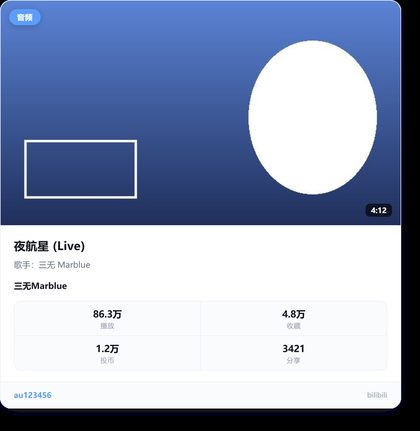
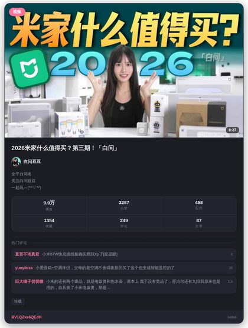

# B站卡片解析

自动识别聊天里的 B 站链接，渲染成一张卡片图，再补一条可复制的链接文字。

覆盖八类内容：视频、番剧、直播、专栏、动态、UP 主空间、音频、视频评论。


## 和其他 B 站解析插件的区别

| | 本插件 | 典型实现 |
|---|---|---|
| 额外依赖 | **无**。借用 AstrBot 内置的 `html_render()` | 常需自行安装 Playwright + Chromium |
| 卡片形态 | 截图成图，16:9 封面 + 数据宫格 + 标签 | 多为文本或 emoji 排版 |
| 内容类型 | 八类，可逐类开关 | 通常只做视频 |
| 是否调模型 | **完全不调**。无 AI 总结、无语音转写 | 部分插件会顺带接 LLM |
| 卡片之外 | 补发一条带原始链接的文字 | 链接常常只存在于图片里，点不动 |

不发 AI 总结是刻意的：解析是确定性任务，多接一层模型只会增加延迟、费用和不确定性。需要视频内容总结的，应该用专门的插件。

「无额外依赖」的确切含义是：渲染交给宿主 `Star.html_render()`，插件自己既不带 Playwright，也不带 Chromium 和字体。但要注意，`html_render()` 走的是 **AstrBot 配置的文转图端点**（默认是 AstrBot 官方的 `t2i.soulter.top`），并非本机渲染——卡片是那台服务器截出来的图。介意卡片文本离开本机的，可以在 AstrBot 配置里把 `t2i_endpoint` 指向自建渲染服务。

## 支持的链接

| 类型 | 示例 |
|---|---|
| 视频 | `bilibili.com/video/BV...`、`av12345`、裸 `BV1xx411c7mD` |
| 番剧 | `bangumi/play/ep...`、`play/ss...`、`media/md...` |
| 直播间 | `live.bilibili.com/22637261` |
| 专栏 | `bilibili.com/read/cv...` |
| 动态 | `bilibili.com/opus/...`、`t.bilibili.com/...` |
| UP 主空间 | `space.bilibili.com/946974` |
| 音频 / 歌单 | `bilibili.com/audio/au...`、`am...` |
| 视频评论 | `video/BV...?comment_root_id=...` |
| 短链 | `b23.tv`、`bili2233.cn` 等，自动展开后再分派 |
| QQ 小程序卡片 | 从 JSON / XML 卡片里提取隐藏链接 |

## 安装

需要 AstrBot `>= 4.16`（`html_render` 的版本要求）。**不需要安装任何额外 Python 依赖。**

在 WebUI 插件管理页通过仓库地址安装，或把本目录放到 `AstrBot/data/plugins/astrbot_plugin_bili_card/` 后重载。

Docker 部署要注意一件事：**容器里必须有中文字体**，否则卡片上的中文会变成方块。

```bash
apt-get update && apt-get install -y fonts-noto-cjk
```

渲染走的是 AstrBot 自己的 Playwright 进程，所以宿主能渲染文转图，这个插件就能出卡片。

## 配置

全部在 WebUI 插件配置页修改，保存后重载生效。

### 基础

| 配置 | 默认 | 说明 |
|---|---|---|
| `auto_parse` | 开 | 关闭后只响应 `/bili` 指令 |
| `reply_mode` | `card_text` | `card_text` 图 + 文字；`card_only` 只发图；`text_only` 只发文字 |
| `parse_limit` | 1 | 单条消息最多解析几个链接（1-3） |
| `cooldown_seconds` | 60 | 同一会话重复分享同一内容的冷却，0 关闭 |
| `error_hint` | 开 | 失败时是否在聊天里说明原因 |

### 解析类型

`types` 分组下十个开关，除 `opus`（动态）外默认全开：`video` `bangumi` `live` `article` `space` `audio` `comment` `short_link` `json_card`。

`opus` 默认关闭。B 站动态详情接口对**公开动态**匿名可用，但仅粉丝可见、受限或命中风控的动态会返回「账号未登录」，所以这一项留给你自己决定要不要开——详见下面的 [Cookie 与登录态](#cookie-与登录态)。

关掉某一类后，该类链接完全不触发，不会出现"解析了一半"的状态。

### 卡片内容

`show_cover` `show_avatar` `show_stats` `show_comments` `comments_count`（默认 3）、`show_desc` `desc_max_chars`（默认 96）、`theme`（`light` / `dark`）。

`comments_count` 是抓取条数，`0` 表示完全不抓。评论只取 B 站「按热度」排序的前几条，取不到时整块自动省略，不影响卡片其余部分。每多一条卡片就高一截，群聊里建议 2~3 条。

### 高级

| 配置 | 说明 |
|---|---|
| `cookie_sessdata` | **只有动态可能用得上**，其余类型一律不需要，不解析动态就留空 |
| `proxy_url` | 直连被墙或被风控时使用。SOCKS 需额外装 `aiohttp-socks` |
| `request_timeout` | 单次接口超时，默认 10 秒 |
| `blocked_groups` | 这些群完全不启用插件 |
| `render_timeout` | 单张卡片出图的总预算，默认 20 秒（切成两次尝试，都超时则退回文字） |
| `debug` | 输出链接识别与接口响应的排查日志 |

## Cookie 与登录态

B 站绝大多数公开接口在未登录状态下就能用，所以这个插件**默认不需要任何 Cookie**，留空即可。只有一类内容例外。

### 不需要 Cookie 的部分

| 内容 | 用到的接口 | 说明 |
|---|---|---|
| 视频 | `x/web-interface/view` | 标题、简介、分 P、六项数据、封面、头像 |
| 番剧 | `pgc/view/web/season` | 番剧信息、评分、集数、播放/追番等数据 |
| 直播 | `room/v1/Room/get_info` + `get_anchor_in_room` | 房间信息、开播状态、人气 |
| 专栏 | `x/article/viewinfo` | 标题、作者、阅读/点赞等 |
| UP 空间 | `x/web-interface/card` | 昵称、签名、等级、粉丝数、投稿数 |
| 音频 | `audio/music-service-c/web/*` | 歌曲与歌单信息 |
| 评论卡片 | `x/v2/reply/reply` | 指定评论及其楼中楼 |
| 热评 | `x/v2/reply?sort=2` | 视频/番剧 `type=1`、专栏 `type=12`、动态按 `comment_type` |
| 短链展开 | `b23.tv` 的 302 跳转 | |
| WBI 签名密钥 | `x/web-interface/nav` | 未登录时返回 `-101`，但 `wbi_img` 照样给；插件只看密钥，不看登录状态 |

### 需要 SESSDATA 的部分

只有**动态**，而且分两半：

| 情形 | 未填 Cookie | 说明 |
|---|---|---|
| 公开动态 | ✅ 可解析 | 实测 `detail` 匿名返回 `code 0`，卡片字段齐全 |
| 仅粉丝可见 / 已关注可见 / 仅自己可见 | ❌ `-101` | 必须填 `cookie_sessdata` |
| 命中风控的动态 | ❌ `-352` / `-412` | 填了通常会好 |

还有一类与登录不直接相关、但填了能缓解的情况：**同一个 IP 短时间解析太频繁**，B 站会返回 `-352` / `-412`。这不是"没 Cookie 就取不到"，而是"没 Cookie 更容易被拦"。

### 怎么拿 SESSDATA

浏览器登录 B 站 → F12 → Application（存储）→ Cookies → `bilibili.com` → 复制 `SESSDATA` 的值。有效期约半年，过期后动态会重新开始报 `-101`，重新复制一次即可。

### 这个值是怎么用的

只作为请求头里的 `Cookie: SESSDATA=...` 发给 `api.bilibili.com`：**不写日志、不进缓存、不打进卡片、也不随卡片提交给文转图端点**。其他类型的请求走同一个会话会带上它，但那些接口本身不依赖它。部署环境要求凭据不出内网的话，留空即可，只损失受限动态这一类。

## 指令

| 指令 | 说明 |
|---|---|
| `/bili <链接或BV号>` | 手动解析，不受自动解析开关限制 |
| `/bilihelp` | 查看版本、开关状态与已启用类型 |

## 卡片样式

六格数据（视频）用两行三列，四格（音频）用两行两列，两格（直播）一行铺满——不会出现半截空行。

视频、番剧单集、专栏、动态都会带上三条热评（`show_comments`），让群友不点开也能看出大家在讨论什么。热评与封面、头像同时并发请求，不会额外多等一轮。

热评取的是 B 站评论区的"热度排序"（`sort=2`），评论区的业务类型按内容自动切换——视频和番剧单集是 `type=1`、专栏是 `type=12`、动态按接口返回的 `comment_type` 走（转载专栏的动态，评论其实挂在 cv 号上，不能拿动态 id 硬套）。

| 评论（无封面） | 音频（四格） |
|---|---|
|  |  |

深色主题（`theme: dark`）：



## 已知限制

**卡片里的链接不可点。** 图片是位图，没有超链接能力。所以 `reply_mode: card_text` 默认会在图后面补一条带原始地址的文字，这是这个默认值存在的原因。

**动态（opus）不是"全部都能解析"。** 公开动态匿名可用，仅粉丝可见、受限或命中风控的会返回「账号未登录」，这类要么填 `SESSDATA`，要么不解析。逐项对照见 [Cookie 与登录态](#cookie-与登录态)。其余八类——视频、番剧、直播、专栏、评论、UP 空间、音频、短链——匿名全部可用。

**评论解析只认带 `comment_root_id` 的链接。** 普通 `#reply123456` 锚点无法还原到接口参数。

**大会员专属、充电专属、付费内容不支持。** 接口层面就拿不到播放数据。

**渲染失败会自动退回文字。** 宿主渲染服务异常时不会静默无响应，而是发一条纯文本，信息不丢。卡片渲染依赖宿主的文转图端点，断网或端点不可用时同样走这条退路。

**出图速度取决于宿主的文转图端点。** 插件这边已经压到最省：封面按显示尺寸向图床要缩略图（341KB → 39KB），并跳过了宿主给模板无条件注入的 2.4MB 代码高亮运行时——这两项合计让一次渲染从 20 秒级降到 2~3 秒。

**端点排队时不会一直干等。** 官方文转图端点是个池子，同一时刻不同端点能差一倍（实测 1.7 秒与 3.2 秒并存），高峰期还出现过单次 48 秒——那种情况是服务端排队，不是你配置的问题。AstrBot 只在请求**报错**时换端点，碰到「慢但最终成功」的端点会一直等，所以插件自己给单次请求设了上限：`render_timeout` 是总预算，先给六成，超时就换端点再用剩下的四成，两次都超时就退回文字。**群里不会出现等了一分钟还没动静的情况。**

如果日志里能看到「卡片出图 x.xs」，说明确实是端点慢；换成自建 `t2i_endpoint` 最直接。

**卡片里的文本会随模板提交给文转图端点。** 视频标题、UP 名、简介、评论正文都在其中。这是 `html_render()` 的工作方式，不是本插件额外发送的；要求数据不出内网的部署，请自建渲染端点。

**同一平台不要同时装两个 B 站解析插件。** 两者都会监听同一条消息，结果是机器人对同一个视频回两次。要么只留一个，要么用各自的群名单隔开。

## 开发

```bash
# 单元测试（131 个用例，纯离线）
python -m unittest discover -s tests -v

# 加载冒烟：不启动 AstrBot，验证 @filter / metadata / html_render 的用法正确
python tools/smoke_test.py

# 本地预览卡片（不需要启动 AstrBot，也不需要装 jinja2）
python tools/preview.py --shot
python tools/preview.py --theme dark --kind video --shot

# 静态检查
ruff check . && ruff format --check .
```

`tools/smoke_test.py` 用桩替身模拟 AstrBot 的核心对象，跑通「消息 → 识别 → 取数据 → 渲染 → 出图+文字」整条链路。改完 `main.py` 先跑它，比在 AstrBot 里反复重载快得多。

`tools/preview.py` 自带一个只支持本模板语法的极简渲染器，用 Chromium 系浏览器截图，方便调版式。它只用于开发，不参与插件运行。

项目结构：

```
astrbot_plugin_bili_card/
├── main.py              # Star 子类，事件入口与流程编排
├── core/
│   ├── api.py           # 八类接口客户端、图片内联
│   ├── wbi.py           # WBI 参数签名
│   ├── link_parser.py   # 链接识别与类型分派
│   ├── models.py        # CardData 等数据模型
│   └── renderer.py      # 卡片上下文构建
├── templates/card.html  # 卡片版式（Jinja2）
├── tools/preview.py     # 本地预览
└── tests/               # 单元测试
```

改版式只需要动 `templates/card.html`，改数据取舍动 `core/renderer.py`，两者职责不重叠。

## 参考与致谢

本插件是独立实现，没有复制任何现有插件的代码。下列项目与资料影响了设计取舍，在此说明来源：

- **AstrBot 官方文档** — [插件开发指南](https://docs.astrbot.app/dev/star/plugin-new.html) 与 [文转图](https://docs.astrbot.app/dev/star/guides/html-to-pic.html)。卡片走 `Star.html_render()` 这条路径来自官方文档，不是自行摸索出的偏方。
- **[jkfujr/astrbot_plugin_bili_parser](https://github.com/jkfujr/astrbot_plugin_bili_parser)** — 它把 B 站链接拆成视频/直播/番剧/专栏/动态/空间/音频八类分别处理，并给出每类的独立开关。本插件的类型划分与「按类型分别启停」的配置形态参照了这个思路。
- **[muyuawa/astrbot_plugin_bilicard](https://github.com/muyuawa/astrbot_plugin_bilicard)** — 证明了「B 站信息值得用截图卡片呈现」这件事，也是本插件坚持保留 16:9 封面、时长角标、数据宫格这一视觉结构的起因。它的封面/头像必须内联才能绕过防盗链，这一点本插件用同样的办法解决。
- **[Volundio/astrbot-plugin-bilibili-analysis](https://github.com/Volundio/astrbot-plugin-bilibili-analysis)** — 参考了它对「同一消息里多种来源（完整链接 / 仅 BV 号 / 短链 / 卡片）」分别开关的做法。

B 站 WBI 签名的置换表与算法属于公开逆向结果，本仓库中的实现依据公开资料重写，未取用上述任何项目的具体代码。`LICENSE` 为 MIT；上述项目各自适用自己的许可协议（其中两个是 AGPL-3.0），如需借鉴它们的代码，请遵守各自的协议。

## 许可证

MIT。B 站接口的可用性与字段稳定性不由本项目控制，接口变更可能导致部分内容解析失败。
